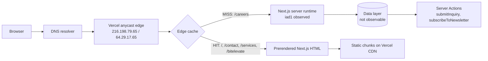

# 01 — Architecture

## Observed path

## Layer evidence

| Layer | Observation | Evidence | Confidence |
|---|---|---|---|
| DNS | A records `216.198.79.65`, `64.29.17.65` for `www`; `216.198.79.1` for apex. Addresses and response headers are consistent with Vercel's anycast edge. | [TLS/DNS](../evidence/tls/README.md) | Confirmed for records; **Strongly inferred** for anycast ownership (no WHOIS/ASN lookup performed) |
| Edge/CDN | `server: Vercel`; `x-vercel-id` starts with `bom1`; `x-vercel-cache: HIT/MISS`; `age` present on cached HTML and assets. | [home](../evidence/headers/home_run1.txt), [careers](../evidence/headers/careers_run1.txt) | Confirmed |
| Edge PoP | `bom1` appears in every `x-vercel-id`. Several responses carry `bom1::iad1::…`, indicating an edge PoP plus a function/region leg in `iad1`. | [contact](../evidence/headers/contact_run1.txt), [careers](../evidence/headers/careers_run1.txt) | **Strongly inferred** — header format is undocumented in this report's scope |
| Application framework | App Router chunk layout (`app/(marketing)/…`, `app/layout-*.js`), React Server Component flight data in inline scripts, `x-nextjs-prerender`, `x-nextjs-stale-time`, `x-powered-by: Next.js` on some routes. | [home HTML](../evidence/raw/home_run1.html), [contact headers](../evidence/headers/contact_run1.txt) | Confirmed |
| Rendering mode | `/`, `/contact`, `/services`, `/bitelevate`: `x-nextjs-prerender: 1` and edge `HIT`. `/careers`: no prerender header, `x-vercel-cache: MISS`, `cache-control: private, no-cache, no-store`. | [headers](../evidence/headers/) | Confirmed for behavior; **Strongly inferred** that `/careers` is dynamically rendered |
| HTTP protocol | HTTP/2 on all responses; `alt-svc` absent, so HTTP/3 was not advertised. TLS 1.3 and `TLS_AES_128_GCM_SHA256` on `www`. | [headers](../evidence/headers/home_run1.txt), [TLS](../evidence/tls/README.md) | Confirmed |
| TLS termination | Separate Let's Encrypt certificates for `cynbit.in` and `www.cynbit.in`, both valid at capture time. | [TLS](../evidence/tls/README.md) | Confirmed |
| Data layer | No database, CRM, or email provider is named in public headers or client bundles. Server Actions return only `{ success }` to the client. | [contact chunk](../evidence/assets/js/contact-page.js) | **Hypothesis** — requires source/config access |
| Server Actions | Action IDs and names are present in public chunks; invocation is a same-origin POST with a `Next-Action` header, per Next.js framework code. No action was invoked. | [contact chunk](../evidence/assets/js/contact-page.js), [layout chunk](../evidence/assets/js/layout-98cfbe01c086f5c9.js) | Confirmed that IDs ship; **Strongly inferred** for transport |

## Redirect and host behavior

| Request | Response | Notes |
|---|---|---|
| `https://cynbit.in/` | `307` → `https://www.cynbit.in/` | `cache-control: public, max-age=0, must-revalidate`; no `includeSubDomains` in HSTS |
| `https://www.cynbit.in/` | `200` | Canonical host in practice |
| `http://cynbit.in/` | `308` → `https://cynbit.in/` | One request observed; `server: Vercel` ([headers](../evidence/headers/http_apex.txt)) |

No `<link rel="canonical">` element was found in the homepage HTML. `og:url` is `https://cynbit.in` while the `200` host is `www.cynbit.in`. This is an SEO consistency issue, not a security defect. Evidence: [home HTML](../evidence/raw/home_run1.html).

## TLS and certificate notes

- `www.cynbit.in` certificate SAN contains only `DNS:www.cynbit.in`; apex certificate SAN contains only `DNS:cynbit.in`.
- Both chains verify successfully (`Verify return code: 0 (ok)`). Separate certificates are valid configuration; they are not a finding.
- HSTS is returned by both hosts, but without `includeSubDomains`. See [SEC-02](../findings/security/SEC-02-hsts-not-subdomain-complete.md).

## What cannot be inferred

- The origin compute runtime, database engine, CRM, and email delivery provider.
- Whether Server Actions have server-side validation, rate limiting, or abuse controls. No action was submitted.
- Whether `/admin/` or `/portal/` exist or are protected. `robots.txt` mentions them, but probing them would violate the brief.
- The actual region serving every request; `x-vercel-id` is evidence of the edge chain, not a guarantee of origin placement.
